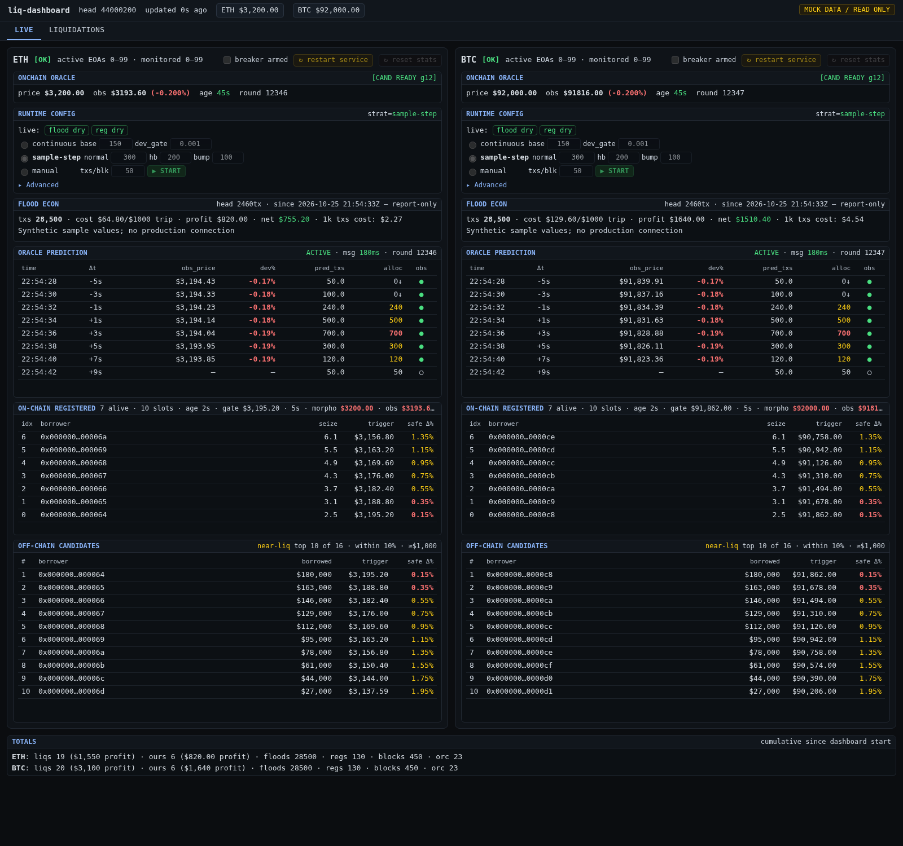
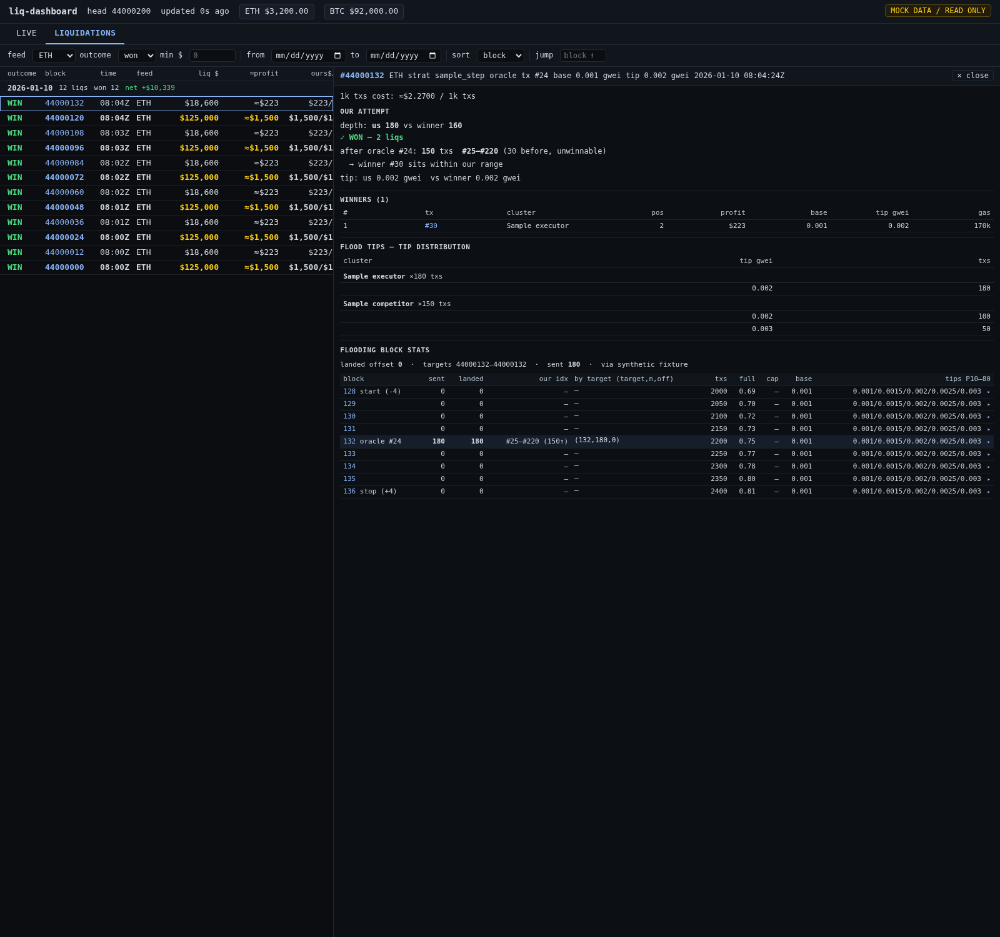

# Liquidation dashboard — mock-data edition

The actual front end from my personal Base/Morpho Blue liquidation dashboard, served by a small offline Go API with synthetic data. The original dark theme, two-column live view, runtime panels, prediction tables, candidate tables and liquidation-detail screens are preserved.





## Run

Requires Go 1.26 or later. Uses only the Go standard library.

```bash
go run .
```

Open <http://127.0.0.1:8088>. For another port:

```bash
go run . -listen 127.0.0.1:8090
```

No API keys, RPC endpoint, wallet, database or external service is needed. The API reads the bundled `examples/dashboard.json` fixture. Nothing is fetched from a chain, and no production data or configuration is included.

## Explore

- **LIVE:** on-chain oracle display, runtime settings, flood economics, oracle predictions, registered candidates, near-liquidation candidates and totals.
- **LIQUIDATIONS:** market/outcome/amount/date filters, original sort choices, infinite scrolling, keyboard navigation, per-block winners and attempt details.
- **Flooding block stats:** synthetic block/transaction context, including expandable tip-percentile windows.
- **Advanced:** inspect the original runtime field layout. Operational inputs, toggles and service buttons are disabled.

Every value, address, transaction and economic outcome is synthetic. The persistent **MOCK DATA / READ ONLY** badge identifies the demo on both tabs. Synthetic explorer links do not navigate to unrelated real transactions.

## Implementation

```text
Bundled mock fixture -> Go HTTP API -> actual dashboard HTML/CSS/JavaScript
```

| File | Responsibility |
|---|---|
| `web/index.html` | Original dashboard UI, with a mock badge and operational-control disabling |
| `main.go` | Offline mock API matching the front end's response shapes |
| `examples/dashboard.json` | Two feed panels, 72 synthetic history records, winners and a block landscape |
| `main_test.go` | Read-only boundary, fixture timing, history filters/pagination and detail consistency |

The UI polls its own local `/api/snapshot` endpoint. Relative fixture timestamps are rebased at response time so the original age and prediction-window displays remain meaningful. The history records have fixed synthetic timestamps.

The history API preserves the original behavior: composite block/feed pagination for block order, and a capped top-N result for profit/size order. It is a small in-memory mock, not the production indexer.

## Publication boundary

This copy preserves the actual presentation code. The original RPC readers, transaction pipelines, strategy engine, databases, systemd controls and operational configuration are excluded. All write methods are rejected by the Go server, even if an API request is made outside the UI. There is no upstream proxy.

The original dashboard uses inline styles and event handlers; the demo retains them. Its content-security policy confines fetches to the local origin while allowing those original inline scripts and styles.

## Checks

```bash
go test ./...
go vet ./...
```

Browser checks cover both tabs, rendered candidate counts, disabled operational controls, history filtering, per-block details, block statistics, expandable tip windows and empty results.

Built by [Adam Du](https://github.com/Beibei-Du). MIT licensed; see [LICENSE](LICENSE).
